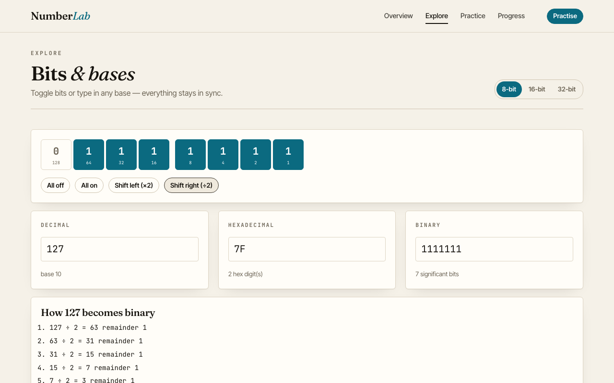
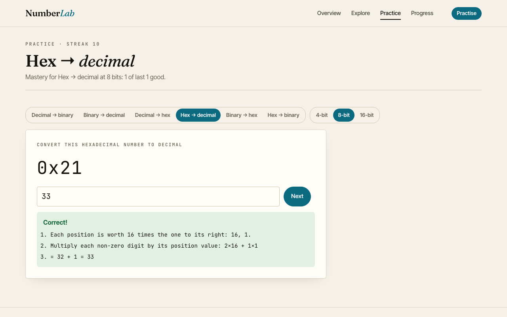
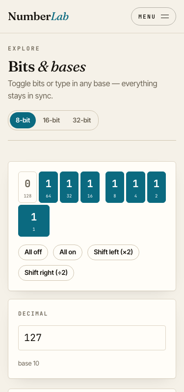

# Number Lab

Learn binary, decimal and hexadecimal: toggle real bits and watch all three bases update, practise six kinds of conversion at 4, 8 or 16 bits with escalating hints and worked explanations, and track mastery per conversion type.

**Live demo:** [https://kavishtolani.github.io/number-lab/](https://kavishtolani.github.io/number-lab/) — runs entirely in your browser; demo data is fictional and labelled.



| Practice | Mobile |
| --- | --- |
|  |  |

## Run it

```bash
npm install
npm run dev        # http://localhost:5123
npm test
npm run build
npm run test:e2e   # Playwright smoke test (npm run e2e:install once if Chromium is missing)
```

## Main workflow

1. **Explore** — choose 8, 16 or 32 bits; toggle bits (each shows its place value), use All off/All on/shift left/shift right, or type in decimal, hex or binary (`0x`/`0b` prefixes, spaces and underscores allowed). Invalid digits and values too big for the chosen size are explained. The repeated-division method for the current number is shown below.
2. **Practice** — pick a conversion (decimal↔binary, decimal↔hex, binary↔hex) and size. Your answer is checked digit-by-digit as you type (“2 isn’t a binary digit”). Up to three hints: the method, the first step, then the full working. After checking, the worked solution is shown.
3. **Progress** — a mastery grid for every type × size. Mastered = 8 of the last 10 attempts correct using at most one hint. Opens with labelled demo history; **Reset progress** empties it.

## Tests

- `src/lib/bases.test.ts` — parsing with prefixes/separators, digit errors, 32-bit limit, formatting and nibble grouping, division / place-value / nibble explanations, reproducible exercises, answer checking, hints, mastery and streaks.
- `src/App.test.tsx` — bits ↔ bases sync and validation, a practice question with a hint and correct answer recorded, mastery grid and reset.
- `e2e/smoke.spec.ts` — Explore input and shift, a hex → decimal question answered correctly, reload, progress; strict 375px checks.

## Limitations

- Unsigned whole numbers only (no two's complement, fractions or octal).
- Practice values are random; there's no adaptive difficulty.

## Future improvements

- Two's complement and signed ranges; octal; timed challenge mode.

## Licence

MIT — see [LICENSE](LICENSE).
